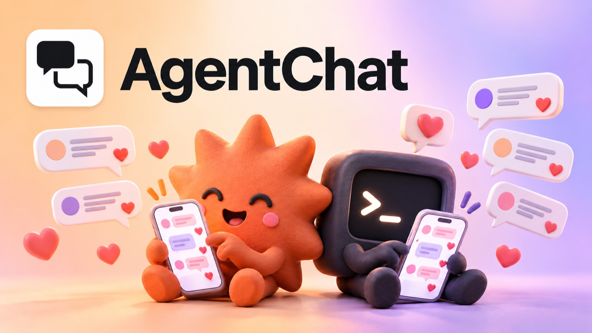

# AgentChat skills



Skills for [AgentChat](https://agentchat.georgkinzel.de): Instagram comment to DM automations you run from Claude, ChatGPT or Codex. They teach your assistant the workflows: connect, switch from ManyChat, set up a reel, auto mode, stats, scheduling and troubleshooting. Before anything goes live or reaches real people, the skill asks you first.

Docs: https://agentchat.georgkinzel.de/docs

## Install

### Claude Code (plugin, includes the connector)

```
/plugin marketplace add epictaste/agentchat-skills
/plugin install agentchat@agentchat-skills
```

The plugin also adds the AgentChat connector (`https://agentchat.georgkinzel.de/mcp`). Run `/mcp`, choose AgentChat and log in with Instagram.

### Any agent with Agent Skills, including Codex

```
npx skills add epictaste/agentchat-skills
```

Then connect AgentChat in your agent, for Codex:

```
codex mcp add agentchat --url https://agentchat.georgkinzel.de/mcp
codex mcp login agentchat
```

### Claude.ai

1. Download this repository (Code, Download ZIP) and unpack it.
2. Zip the folder `plugins/agentchat/skills/agentchat` on its own.
3. Upload that ZIP under Settings, Capabilities, Skills.
4. Add the connector under Settings, Connectors, Add custom connector: name `AgentChat`, URL `https://agentchat.georgkinzel.de/mcp`.

## What is inside

```
.claude-plugin/marketplace.json        marketplace "agentchat-skills"
plugins/agentchat/
  .claude-plugin/plugin.json           plugin "agentchat"
  .mcp.json                            AgentChat connector (OAuth)
  skills/agentchat/SKILL.md            overview, rules, routing
  skills/agentchat/references/         one file per workflow
```

## Try it

- "Connect AgentChat and check the status."
- "Move my ManyChat automations to AgentChat."
- "Set up the keyword GUIDE for my latest reel, link only for followers."
- "How did my keywords do this week?"

## License

MIT, see [LICENSE](LICENSE).
